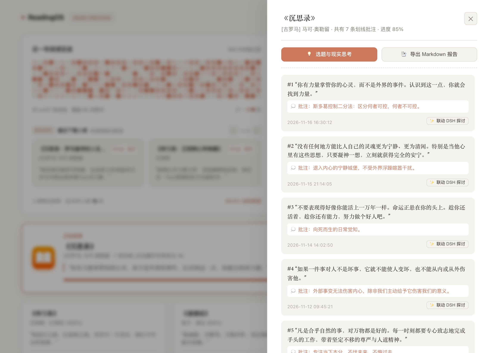
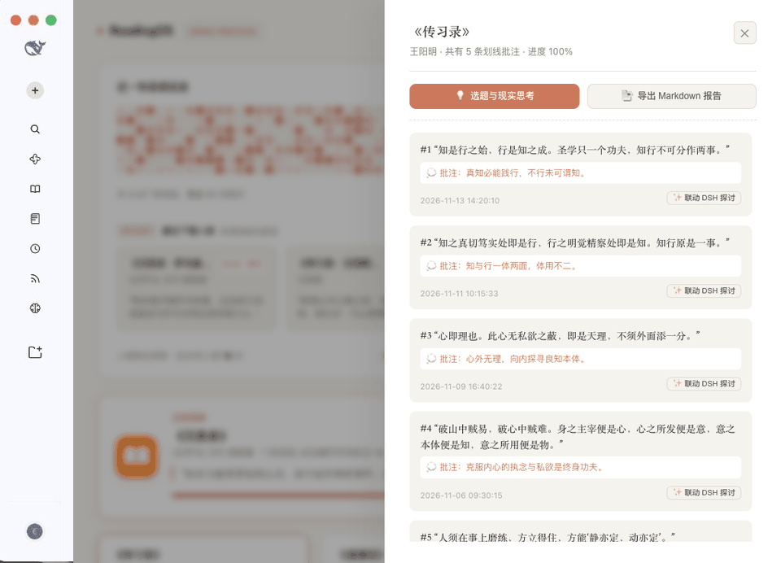

<p align="center">
  
</p>

<h1 align="center">ReadingOS for DeepSeek Harness</h1>

<p align="center">
  Keep your macOS Apple Books highlights and annotations close at hand during daily reflection.
</p>

<p align="center">
  <b>English</b> · <a href="README.md">简体中文</a>
</p>

<p align="center">
  
  
  
  
</p>

---

### What Problems Is This Plugin Considering?

When reading electronic books, I often use the native "Books" (Apple Books) app on Mac or iPad, highlighting meaningful passages whenever inspiration strikes.

In practice, this specific reading habit often encounters several subtle frictions:

- **Highlights get buried and forgotten**: Annotations stay quietly tucked away in system databases, rarely revisited once a book is closed.
- **Exporting is inconvenient**: Native sharing typically requires emailing quotes to oneself and manually piecing notes together paragraph by paragraph.
- **Switching contexts with AI models is cumbersome**: Quoting a resonant sentence to explore deeper with an AI model requires constant window switching and manual copy-pasting.

It runs unobtrusively in the DeepSeek Harness sidebar, reads local data directly, and provides a calm, peaceful interface to browse your reading thoughts.

---

### Core Modules

#### 1. Year in Highlights Footprint
Reads your local Books database to visualize your reading rhythm over the past year through a heatmap—when you read most actively, how many highlights you made, and how your reading distributes across knowledge dimensions.

<p align="center">
  
</p>

---

#### 2. Currently Reading & Companions
Displays books recently opened in Apple Books alongside your current progress, making it effortless to pick up right where your thoughts left off, accompanied by frequently revisited companion books.

<p align="center">
  
</p>

---

#### 3. Cross-Book Theme Resonances
Brings together highlights from different books that share common themes (such as "Unity of Knowledge and Action" or "First Principles"), allowing you to expand 3 books side-by-side to compare how different authors articulate the same idea.

<p align="center">
  
</p>

---

#### 4. Single-Book Highlights Drawer & Markdown Export
Clicking any book slides out a right drawer containing all highlights and annotations for that title. Easily copy quotes, export a clean Markdown summary, or send a selected sentence directly into the AI chat to discuss.

<p align="center">
  
</p>

---

#### 5. Daily Spark & Tsundoku Reminder
Two lightweight cards at the bottom: **Spark Bookmark** surfaces a random past highlight with each click (great for brief work breaks), while **Tsundoku Awakening** recalls downloaded books that have remained unread, gently reminding you to open them.

<p align="center">
  
</p>

---

#### 6. One-Click DeepSeek Discussion Bridge
In day-to-day reading, discussing a highlighted passage with AI usually requires: selecting and copying text in Apple Books ➔ switching to the AI chat app ➔ pasting ➔ manually stripping out the system-appended copyright disclaimer ➔ sending the prompt.

ReadingOS streamlines this into a single click:
- **Zero Copy-Paste**: Click **`✨ 联动探讨`** from any highlight drawer or serendipity card to pass the book title, author, and clean quote directly into the DeepSeek Harness chat window.
- **Flexible Prompt Preferences**: In the top-right `⚙️` settings, choose between the default structured deep-dive guide, a minimal **"Raw Quote Only (No Prompt)"** mode that leaves full freedom to your own words, or a custom prompt template.

<p align="center">
  
</p>

---

### Suitable Habits & Scope

This is merely one attempt tailored for a specific way of reading—it is by no means a one-size-fits-all solution. Before installing, please check if it fits your daily routine:

| Dimension | Fits Well | Not Yet Applicable |
| :--- | :--- | :--- |
| **Operating System** | **macOS** (relies on reading the local SQLite database of Apple Books) | Windows, Linux |
| **Reading Habit** | Habitually reading EPUB / PDF in **Apple Books on macOS** and highlighting sentences (synced across devices via iCloud) | Primarily using WeChat Read, Kindle, or other third-party cloud apps, or reading without taking highlights |
| **Book Files** | E-books saved in `~/Downloads` (customizable in UI settings) | Cloud-only reading with no local book files |

---

### Data Reading & Settings

- **Automatic Detection Out-of-the-Box**: The plugin automatically detects highlights from macOS Apple Books and scans your `~/Downloads` folder for books. On first launch without cache, it silently performs an initial sync.
- **Visual Settings & Custom Paths**: If your books are saved elsewhere or stored on an external SSD, click the **`⚙️` (Preferences)** button in the top-right corner to customize paths directly (shared with both the dashboard and AI tools)—no terminal commands required.
- **Initial Permission Check**: Operates strictly in read-only mode. If macOS prompts for folder access on first run, simply click **Allow**.
- **Verified Environment**: Verified on MacBook Pro (13-inch, macOS 15.8.2 Sequoia); compatible with macOS 12+ across both Apple Silicon and Intel Macs.

---

### Sync & Privacy

- **On-Demand Sync**: Runs one silent sync on first launch when uncached; click the "Sync" button in the top header whenever you wish to refresh reading records—no background polling.
- **Strictly Local & Read-Only**: Zero network requests, 100% offline. Queries your local database in read-only mode, never modifying your original files.

---

### Installation

1. Open the **DeepSeek Harness** desktop client;
2. Click **"🧩 Plugins" ➔ "Add Plugin"** at the bottom of the left sidebar;
3. Enter the repository URL and click Install:
   ```text
   https://github.com/maikaojai/dsh-plugin-reading-os
   ```
4. Once installed, the **`📖 ReadingOS`** icon will appear on the sidebar.

---

### In Closing

Finally, if you happen to share a similar reading routine, I hope this provides a quiet, undisturbed space for your reflection.

Crafted with care by [@maikaojai](https://github.com/maikaojai)

---

### License

This project is licensed under the [MIT License](LICENSE).
